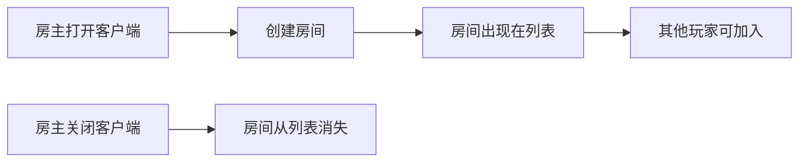
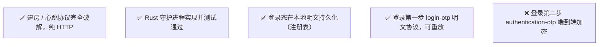
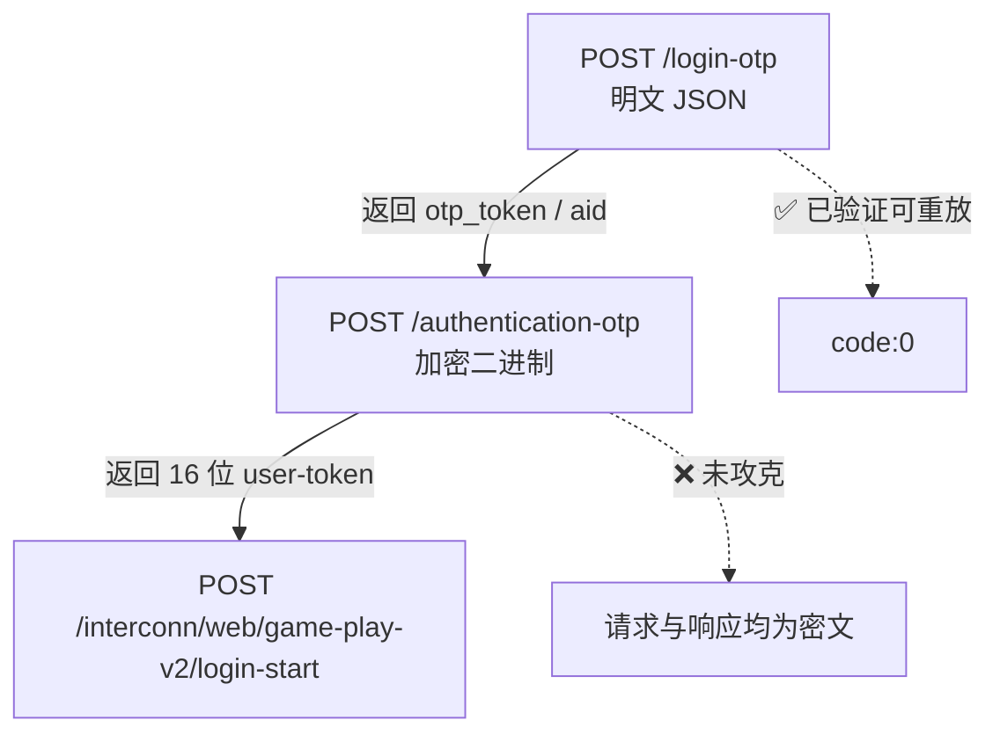
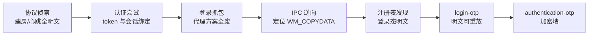

# 01 背景与目标

> 这篇讲清楚：我们想做什么、最后做到了哪一步、为什么停在现在这个位置。

## 要解决的问题

网易《我的世界》中国版的「联机大厅」里，房间依附于房主客户端：

官方对此的付费方案是「租赁服」（7×24 在线）。本项目想验证的是：**能否用协议层的手段，在无图形环境的服务器上让房间保持在线。**

## 最终做到哪一步

**一句话结论**：协议层已经通，只差登录第二步的加密握手。

## 为什么卡在第二步

认证链路是这样的：

第一步已经能用 `libcurl` / `reqwest` 直接重放（实测返回 `code:0`），
但第二步的请求体（约 2657 字节）和响应体（gzip 后仍是密文）都是加密的。

## 走到这一步的路径

| 阶段 | 关键结论 |
|---|---|
| 协议侦察 | 建房/心跳全部明文，无签名 |
| 认证尝试 | token 与会话绑定，同账号互斥（`code:22`） |
| 登录抓包 | 系统代理、WinHTTP、CEF 三条路全部失败 |
| IPC 逆向 | 定位 `WM_COPYDATA` + 窗口类名，数据加密未解 |
| 注册表发现 | **登录态明文持久化**，不需要启动器运行 |
| `login-otp` | 明文协议，重放成功 |

## 下一步方向

详见 [09 登录第二步](09-authentication-otp.md)，三个候选方向：

1. 用 IDA 分析 `NtUniSdkRoostX.dll` 的加密初始化
2. hook 熵源 / 随机数生成，观察会话密钥何时产生
3. 对比两次抓包的密文，判断是「每次随机 IV」还是「固定密钥」

## 阅读顺序建议

| 你想了解 | 读哪几篇 |
|---|---|
| 整体全貌 | 01 → 02 → 14 |
| 只想抓包 | 03 → 04 → 05 |
| 想实现建房/心跳 | 06 → 07 → `examples/` |
| 想攻登录 | 08 → 09 → 11 → 12 |
| 想少踩坑 | 13 |
