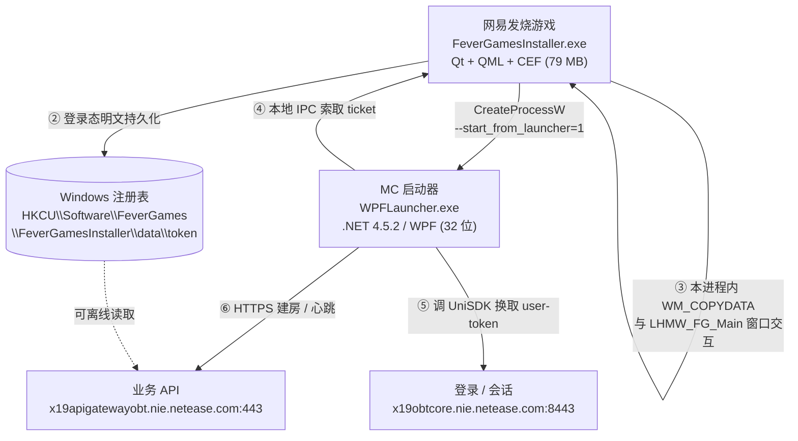
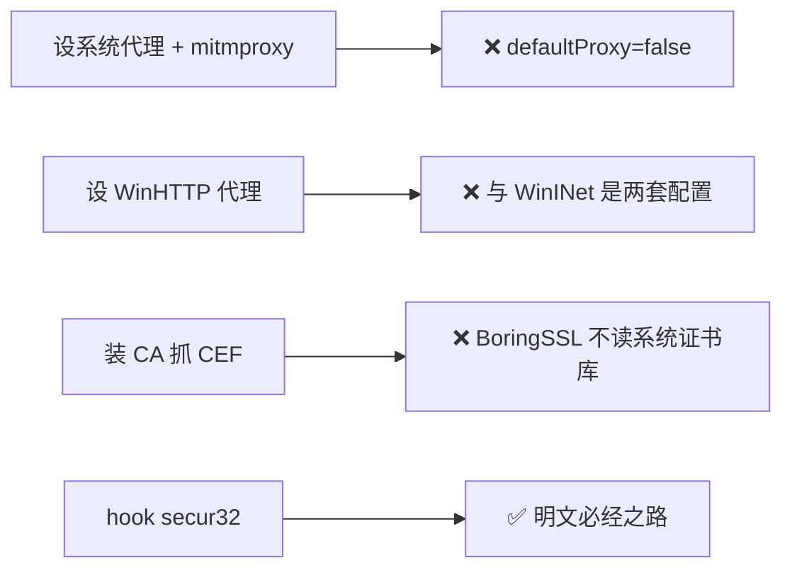

# 02 客户端拓扑

> 这篇讲清楚：有几个进程、各自用什么技术栈、TLS 走哪条路。**抓包策略完全由这张图决定。**

## 进程与数据流

## 进程与技术栈对照

| 进程 | 技术 | TLS 实现 | 抓包可行性 |
|---|---|---|---|
| `FeverGamesInstaller.exe` | Qt + QML + CEF | 混合：CEF 用 BoringSSL，原生用 Schannel | 差 |
| `FeverGamesWeb.exe` | CEF 渲染/GPU 进程 | BoringSSL | 差 |
| `WPFLauncher.exe` | .NET Framework 4.5.2 / WPF | **Schannel（`secur32`）** | **好** |
| `Minecraft.Windows.exe` | 游戏本体 | RakNet（UDP） | 不需要 |

## 为什么这个拓扑很重要

它直接否掉了三种常见的抓包思路：

同时也提示了正确方向：

> `WPFLauncher.exe` 是 32 位 .NET 程序，HTTP 走 Windows 原生 Schannel。
> **明文必经 `secur32.dll` 的 `EncryptMessage` / `DecryptMessage`。**

## 版本信息（实测）

| 组件 | 版本 |
|---|---|
| `WPFLauncher.exe` | `1.15.31.20647`（x86） |
| 网易发烧游戏 | `1.18.45.8` |
| UniSDK | `sdk_version 4.10.0` |

## 关键文件位置

| 内容 | 路径 |
|---|---|
| MC 启动器 | `C:\FeverApps\MC\WPFLauncher.exe` |
| 发烧游戏 | `C:\Program Files\FeverGames\<版本>\FeverGamesInstaller.exe` |
| UniSDK | `C:\FeverApps\MC\NtUniSdk*.dll` |
| CEF 缓存 | `%LOCALAPPDATA%\FeverGames\FeverGamesInstaller\cache\CefCache` |
| 登录态 | `HKCU\Software\FeverGames\FeverGamesInstaller\data\token` |

## 下一步

- 想开始抓包 → [03 抓包环境与选型](03-capture-setup.md)
- 想看具体 hook 代码 → [04 Schannel Hook](04-schannel-hook.md)
