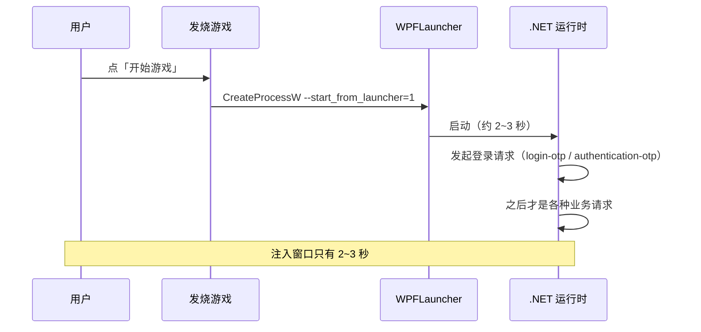
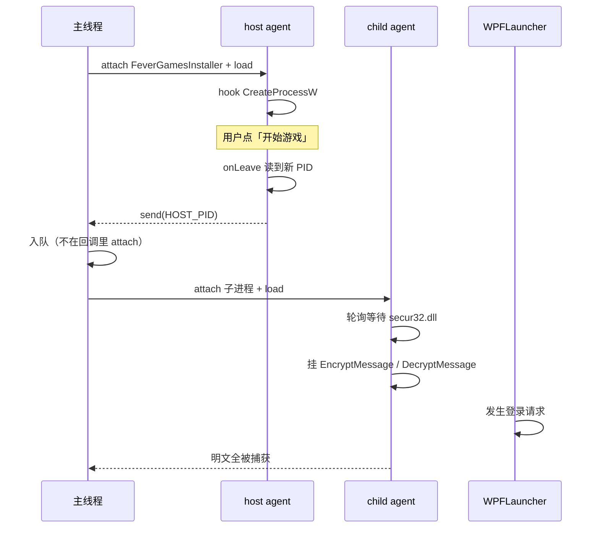

# 05 进程启动瞬间注入

> 登录请求发生在 `WPFLauncher.exe` 启动的头几秒。注入晚一点就全错过。
> 这篇讲清楚三种尝试、为什么前两种失败，以及最终可用的方案。

## 问题



要在「登录请求发出之前」把 hook 装好，窗口只有 **2~3 秒**。

## 尝试一：全量 spawn（失败）

```python
pid = device.spawn([EXE, "--start_from_launcher=1"])
session = device.attach(pid)
script.load()
device.resume(pid)
```

**结果**：进程起来了，但**完全不发起登录 IPC**。

**原因**：`spawn` 绕过父进程（发烧游戏），缺少触发登录所需的上下文。

> 结论：必须走正常启动，不能用 spawn 伪造。

## 尝试二：挂起法（失败）

思路是拦 `CreateProcessW` 时给 `dwCreationFlags` 加上 `CREATE_SUSPENDED`（`0x4`），
注入完再 `ResumeThread`：

```javascript
Interceptor.attach(cp, {
  onEnter: function (a) {
    this.pi = a[9];                                  // lpProcessInformation
    a[5] = ptr(a[5].toInt32() | 0x4);                // dwCreationFlags |= CREATE_SUSPENDED
  }
});
```

**结果**：`frida.attach(pid)` 直接卡死。

**原因**：挂起的进程主线程没运行，`DllMain` 不会执行，Frida 的注入等待永远不返回。

> 结论：**不要在挂起状态下 attach**。

## 尝试三：回调里直接注入（失败 —— 死锁）

```python
def on_message(msg, data):
    if msg["payload"]["dir"] == "HOST_PID":
        ses = frida.attach(int(msg["payload"]["body"]))   # ← 死在这里
```

**结果**：整个脚本卡住，没有任何输出。

**原因**：`on_message` 运行在 Frida 的 Python 回调线程里，
在此调用 `frida.attach()` 会造成重入死锁。

## 最终方案：回调只入队，主线程注入



实现：

```python
import queue, time, frida

q = queue.Queue()

def on_host_msg(msg, data):
    if msg["type"] == "send":
        p = msg["payload"]
        if p.get("dir") == "HOST_PID":
            q.put(int(p.get("body")))      # 只入队，不做别的

# 主线程负责注入
while time.time() < end:
    try:
        newpid = q.get(timeout=0.5)
    except queue.Empty:
        continue
    ses = frida.attach(newpid)             # 在主线程里 attach
    cs = ses.create_script(CHILD_AGENT)
    cs.on("message", on_child_msg)
    cs.load()
```

配套的 host 侧脚本：

```javascript
var k = Process.findModuleByName("kernel32.dll");
var cp = k ? k.findExportByName("CreateProcessW") : null;

Interceptor.attach(cp, {
  onEnter: function (a) { this.pi = a[9]; },
  onLeave: function (r) {
    if (r.toInt32() !== 0 && this.pi && !this.pi.isNull()) {
      try {
        var ps = Process.pointerSize;
        var pid = this.pi.add(ps * 2).readU32();      // PROCESS_INFORMATION.dwProcessId
        send({ dir: "HOST_PID", body: String(pid) });
      } catch (e) {}
    }
  }
});
```

## 子进程侧：等模块加载再挂钩

注入成功不代表能挂钩——`.NET` 尚未初始化时 `secur32.dll` 还没加载：

```javascript
var hooked = false;

function tryHook() {
  if (hooked) return;
  var m = Process.findModuleByName("secur32.dll");
  if (!m) {
    setTimeout(tryHook, 150);     // 每 150ms 重试
    return;
  }
  // ... 在这里 attach EncryptMessage / DecryptMessage
  hooked = true;
  send({ dir: "KID_INSTALL", body: "mod=" + m.name });
}
tryHook();
```

**判据**：如果日志里出现 `enc=false dec=false`，说明注入太早，模块还没加载。

## 三个不能做的事

| 不要 | 原因 |
|---|---|
| 在 Frida 回调线程里 `attach` | 重入死锁 |
| attach 挂起的进程 | `DllMain` 不执行，等待永不返回 |
| 用 `spawn` 伪造启动 | 缺少父进程上下文，不触发登录 |

## 下一步

- 抓到的明文是什么 → [06 建房](06-lobby-room-api.md)
