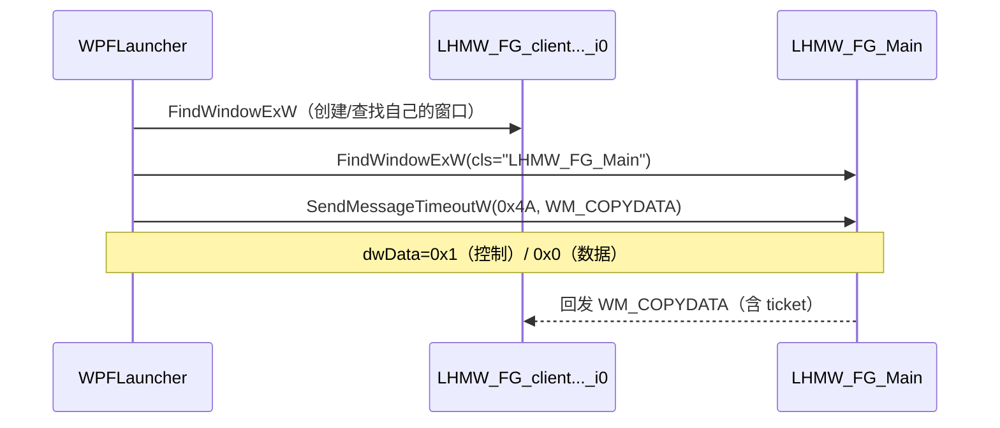
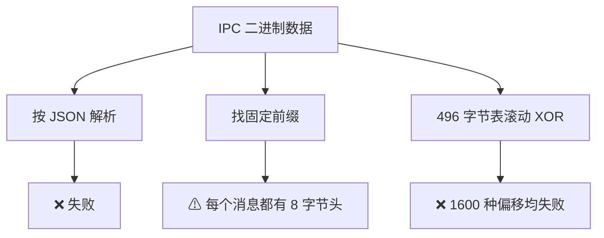
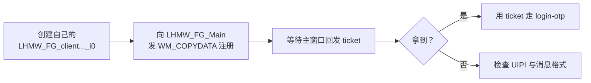

# 11 本地 IPC 与 ticket

> 客户端之间不通过 HTTP 传递登录票据，而是走**本地窗口消息**。
> 这篇记录通道、消息格式、以及还没解开的加密层。

## 背景

`FeverGamesLauncher.exe` 里有这样一条错误字符串：

```text
can not get ticket from Fever Games, you may need to check login status in Fever Games
```

说明它要向「发烧游戏」索取 ticket，拿不到就报错。

## 通道定位

通过 IDA 反汇编定位到：

```asm
xor  edx, edx        ; hWndChildAfter = 0
lea  rcx, [rdx-3]    ; hWndParent = -3 = HWND_MESSAGE
call FindWindowExW
```

`HWND_MESSAGE (-3)` 意味着**消息专用窗口**（不可见的 message-only window）。

配合：

```asm
mov  edx, 4Ah                        ; Msg = WM_COPYDATA (0x4A)
call SendMessageTimeoutW
```

**结论：ticket 通过 `WM_COPYDATA` 在 message-only 窗口之间传递。**

## 窗口类名

| 常量/格式 | 说明 |
|---|---|
| `LHMW_FG_` | 类名前缀（IDA 里的字符串） |
| `LHMW_FG_Main` | 主窗口（实际枚举到的） |
| `LHMW_FG_p<pid>_i<n>` | 格式串 `p%s_i%d` 构造的实例窗口 |
| `LHMW_FG_client<sid>_i0` | WPFLauncher 侧创建的客户端窗口 |

实际枚举结果（`HWND_MESSAGE` 子窗口）：

```text
cls=LHMW_FG_Main  title=LHMW_FG_Main  pid=<发烧游戏主进程>
```

## 交互时序（实测抓取）



抓到的日志片段：

```text
FIND cls=[LHMW_FG_clientFGpx19_i0]
FIND cls=[LHMW_FG_Main]
CD   dw=0x1 cb=12
CD   dw=0x0 cb=272
```

## COPYDATA 数据结构

32 位进程下的 `COPYDATASTRUCT`：

```text
+0  dwData   ULONG_PTR (4B)
+4  cbData   DWORD     (4B)
+8  lpData   PVOID     (4B)
```

| dwData | 含义（推断） |
|---|---|
| `0x0` | 数据消息 |
| `0x1` | 控制消息 |

数据内容是**部分明文 + 部分加密**：

```text
0c010000 0a000000 4e414d45 ("NAME") ...
0c010000 0a000000 52534131 ("RSA1") ...
```

可见标识：`NAME`、`RSA1`。

## 未解的部分

对 IPC 数据尝试过：



> 结论：IPC 数据的加密方式与 `FeverGamesLauncher.exe` 里那段 XOR 循环**不是同一套**。

## 有用但还没用上的线索

IDA 反汇编里出现的组件名：

```text
ncgipc::Register
ncgipc::RegisterThread
ncgipc::Send
ncgipc::ServerCallback
ncgipc::ServerStart
components\ipc\NCGIPCMessage.cpp
IPCPlugin::onOperation(int, int, QString)
IPCPlugin::onOperationAck
IPCPlugin::sigOperationAck
"_operation": 0
"[deeplink-params][ipc] persisted for gid={}, value={}"
```

`onOperation(HH, QString)` 说明协议是「两个整型操作码 + 字符串负载」，
`"operation": 0` 说明消息体是 JSON 的形态（但传输时被加密）。

## 如果要用这条链路

思路是「**不让别人传，自己去拿**」：



难点：

- 需要绕过 `ChangeWindowMessageFilterEx` 的 UIPI 限制（跨进程消息）
- 需要还原 `ncgipc` 的消息格式与加密

## 相关

- ticket 拿到后怎么用 → [08 登录第一步](08-login-otp.md)
- 静态分析细节 → [12 IDA 工作流备忘](12-ida-workflow.md)
