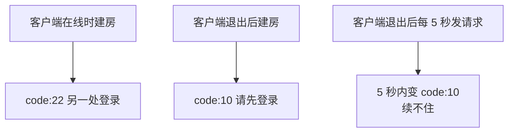
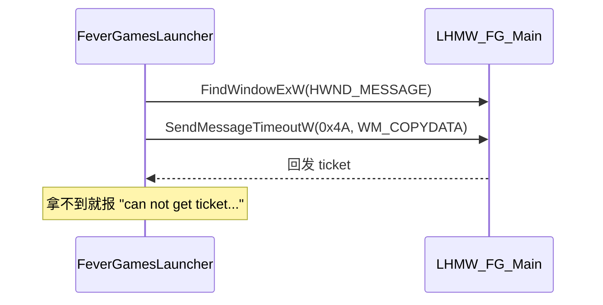
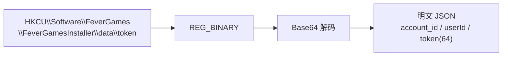
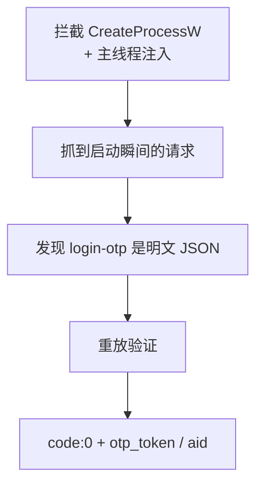

# 14 事件时间线

> 从「完全不知道能不能做」到「只差一道加密握手」的完整路径。

## 总览

## 阶段一：协议侦察

**目标**：先搞清楚建房/心跳是不是纯 HTTP。

**做法**：hook `WPFLauncher` 的 `secur32`，抓明文请求。

**结论**：

- 建房 `POST /online-lobby-room`，明文 JSON
- 心跳 `POST /online-lobby-member-tick`，30 秒周期
- 鉴权只要 `user-id` + `user-token` 两个头，**没有签名**

## 阶段二：认证可行性

**目标**：能不能用自己的 token 独立跑。

**结论**：token 与会话绑定，退出即注销。纯协议方案需要「自己完成登录」。

## 阶段三：登录抓包（三次失败）

**目标**：抓住登录请求。

| 尝试 | 覆盖 | 结果 |
|---|---|---|
| 系统代理 → mitmproxy | CEF 页面请求 | 抓到页面，**无登录** |
| WinHTTP 代理 | 原生请求 | 同样**无登录** |
| 全量枚举代理内接口 | 23 个接口 | 只有查询类 |

**原因**：登录页在 CEF 里（BoringSSL），且原生层用 Schannel，都不走系统代理。

## 阶段四：IPC 逆向

**目标**：ticket 到底怎么传的。

**结果**：定位了通道与窗口类名，但**数据加密未解**（1600 种 XOR 偏移组合均失败）。

## 阶段五：注册表突破

**目标**：换思路找凭证。

**意义**：登录态不需要启动器运行即可读取。**「无图形环境」从不可能变成有希望。**

## 阶段六：login-otp 破解

**目标**：登录接口能不能复现。

**结论**：登录第一步完全可复现，纯 HTTP，无需图形。

## 阶段七：authentication-otp（当前卡点）

**目标**：用 `otp_token` 换最终会话。

**观测**：

- 请求体 2657 字节，高熵密文
- 响应体 2520 字节，gzip 后仍是密文
- 两次抓包密文前缀不同 → 不是固定密钥 XOR

**结论**：端到端加密，需要逆向密钥协商。**目前停在这里。**

## 当前状态一览

| 状态 | 项 |
|---|---|
| ✅ | 建房 / 心跳协议 |
| ✅ | Rust 守护进程（编译通过、测试通过） |
| ✅ | 注册表登录态定位 |
| ✅ | login-otp 明文协议 + 重放验证 |
| ✅ | 会话互斥 / 失效机制实测 |
| ❌ | authentication-otp 加密 |
| ❌ | refresh_token → access_token 刷新接口 |

## 下一步建议

| 优先级 | 方向 | 依据 |
|---|---|---|
| 高 | hook 熵源（`BCryptGenRandom` 等） | 判断会话密钥是否随机 |
| 高 | 对比两次抓包密文 | 固定密钥 vs 随机 IV |
| 中 | hook AES/RSA 原语 | 直接看明文与密钥句柄 |
| 低 | 逆向 `ncgipc` 消息格式 | 换一条路拿 ticket |

详见 [09 登录第二步](09-authentication-otp.md)。
